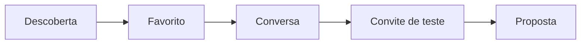
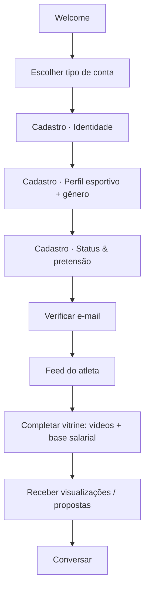
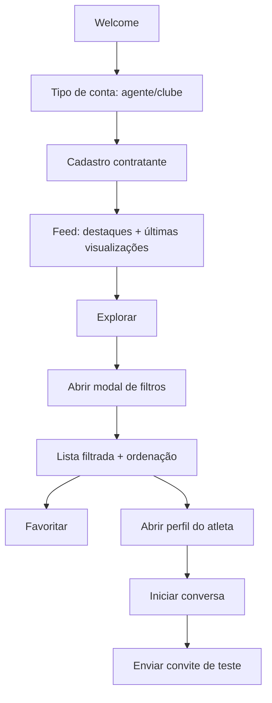
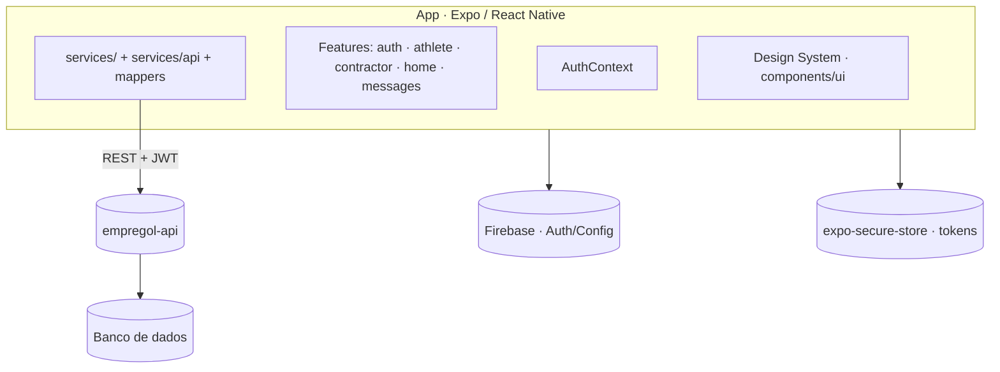
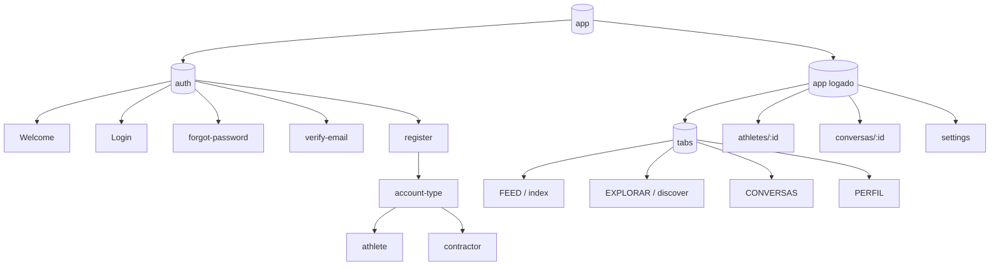
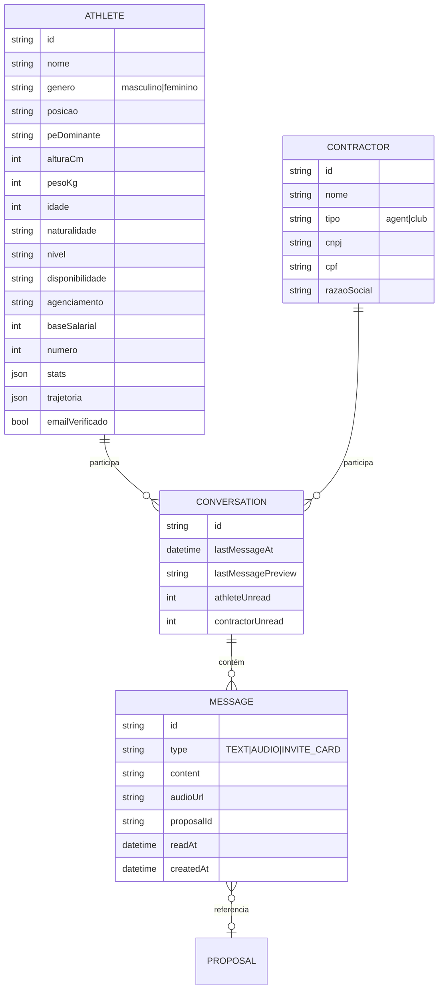
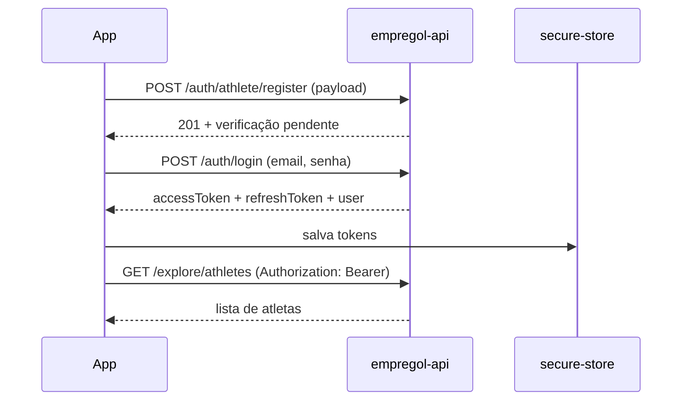
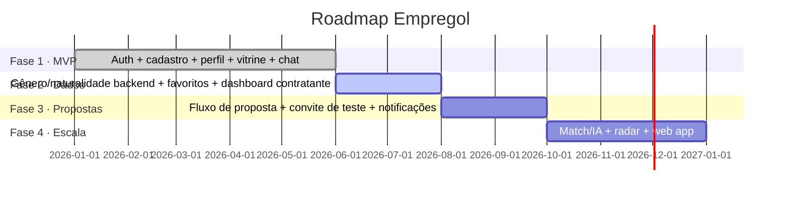

<!--
  Empregol — Product Requirements Document
  Documento em Markdown, pensado para conversão em PDF profissional.
  Sugestão de conversão: VS Code "Markdown PDF" (renderiza Mermaid) ou
  pandoc docs/PRD.md -o PRD.pdf --toc --pdf-engine=wkhtmltopdf
-->

<div align="center">

# ⚽ EMPREGOL

## Marketplace de Futebol

### Product Requirements Document

**Versão 1.1**

`Conecta atletas a clubes e agentes — descoberta, dados verificáveis e negociação direta.`

| | |
|---|---|
| **Produto** | Empregol |
| **Versão do app** | 1.0.0 |
| **Versão do documento** | 1.1 |
| **Plataformas** | iOS · Android · Web (estático) |
| **Bundle** | `com.empregolapp` |
| **Status** | MVP em desenvolvimento ativo |
| **Confidencialidade** | Interno / Investidores |

</div>

<div style="page-break-after: always;"></div>

---

## Índice

1. [Visão do Produto (Product Vision)](#1-visão-do-produto-product-vision)
2. [Sumário Executivo](#2-sumário-executivo)
3. [Problema e Oportunidade](#3-problema-e-oportunidade)
4. [Análise de Concorrência](#4-análise-de-concorrência)
5. [Objetivos, North Star e KPIs](#5-objetivos-north-star-e-kpis)
6. [Personas](#6-personas)
7. [User Stories](#7-user-stories)
8. [Escopo e Priorização (MoSCoW)](#8-escopo-e-priorização-moscow)
9. [Jornadas e Fluxos](#9-jornadas-e-fluxos)
10. [Arquitetura e Stack Técnica](#10-arquitetura-e-stack-técnica)
11. [Arquitetura de Informação e Navegação](#11-arquitetura-de-informação-e-navegação)
12. [Requisitos Funcionais e Critérios de Aceitação](#12-requisitos-funcionais-e-critérios-de-aceitação)
13. [Requisitos Não-Funcionais](#13-requisitos-não-funcionais)
14. [Modelo de Dados](#14-modelo-de-dados)
15. [API e Fluxo de Autenticação](#15-api-e-fluxo-de-autenticação)
16. [Design System](#16-design-system)
17. [Wireframes das Telas Principais](#17-wireframes-das-telas-principais)
18. [Matriz de Rastreabilidade](#18-matriz-de-rastreabilidade)
19. [Regras de Negócio](#19-regras-de-negócio)
20. [Roadmap por Fases](#20-roadmap-por-fases)
21. [Instrumentação e Analytics](#21-instrumentação-e-analytics)
22. [Riscos e Mitigações](#22-riscos-e-mitigações)
23. [Pendências de Backend](#23-pendências-de-backend)
24. [Glossário](#24-glossário)
25. [Anexo — Telas Implementadas (Changelog)](#25-anexo--telas-implementadas-changelog)

> 💡 **Legenda de status:** **[Implementado]** já está no app · **[Parcial]** existe no app mas depende de backend · **[Planejado]** previsto para fases futuras.

<div style="page-break-after: always;"></div>

---

## 1. Visão do Produto (Product Vision)

> **Visão.** Tornar o Empregol a **maior porta de entrada digital do futebol da América Latina** — o lugar onde todo atleta, do amador ao profissional, tem uma vitrine verificável, e onde todo clube e agente encontra, avalia e negocia talento em minutos, com dados confiáveis e um canal direto de conversa.

**Missão.** Democratizar a descoberta de talentos no futebol, substituindo redes de contato fechadas por um marketplace transparente, padronizado e mensurável.

**Proposta de valor (por lado):**
- **Atleta:** "Sua carreira tem uma vitrine. Fique visível para quem contrata."
- **Contratante:** "Encontre o atleta certo pelos critérios que importam — e fale direto com ele."

**Princípios de produto:**
1. **Dados antes de opinião** — a ficha padronizada e verificável é o coração do produto.
2. **Dois mundos, um app** — a experiência do atleta (clara) e a do contratante (escura) são deliberadamente distintas.
3. **Do interesse à ação** — todo sinal (visualização, favorito) tende a uma conversa e a um convite de teste.
4. **Confiança por design** — verificação, privacidade de dados sensíveis e selo de conta.

<div style="page-break-after: always;"></div>

---

## 2. Sumário Executivo

O **Empregol** é um marketplace mobile que conecta **atletas de futebol** a **contratantes** (clubes e agentes/empresários). O atleta monta uma vitrine (perfil esportivo verificável, vídeos, estatísticas e pretensão salarial) e fica descobrível; o contratante explora, filtra e favorita atletas, e abre conversas diretas para negociar testes e propostas.

O funil central do produto é:



Diferenciais: **identidade editorial forte**, **dados verificáveis**, e **experiência por papel** (atleta em canvas claro/creme; contratante em canvas escuro `#141413`).

<div style="page-break-after: always;"></div>

---

## 3. Problema e Oportunidade

**Problema.** A descoberta de talentos no futebol — sobretudo fora da elite — é informal, fragmentada e dependente de redes fechadas. Atletas livres ou em fim de contrato têm baixa visibilidade; clubes e agentes perdem tempo com informação não padronizada, sem dados confiáveis nem canal direto e rastreável.

**Oportunidade.** Padronizar a "ficha" do atleta, tornar o interesse mensurável (quem viu, quantas propostas) e oferecer mensageria com convites de teste estruturados.

> 📌 **Insight-chave:** o gargalo não é falta de talento, é falta de **visibilidade padronizada + canal de contato confiável**. O Empregol ataca exatamente esse gap.

<div style="page-break-after: always;"></div>

---

## 4. Análise de Concorrência

| Produto | Foco principal | Força | Lacuna que o Empregol preenche |
|---|---|---|---|
| **Transfermarkt** | Estatísticas e valores de mercado | Base histórica enorme | Não é marketplace; sem contato direto nem atletas amadores |
| **Wyscout / InStat / Hudl** | Scouting técnico (vídeo/dados) | Profundidade analítica | Caro, B2B elite, sem canal de negociação nem foco no atleta base |
| **LinkedIn** | Networking profissional genérico | Alcance | Não é vertical de futebol; sem ficha esportiva nem disponibilidade |
| **Grupos de WhatsApp / empresários** | Contato informal | Confiança pessoal | Sem padronização, sem dados verificáveis, não escalável |
| **Empregol** | **Marketplace atleta↔contratante + mensagens** | **Ficha padronizada + descoberta + chat + convite de teste** | — |

**Posicionamento:** *"O marketplace onde talento vira contato."* Empregol é a ponte entre o dado (Transfermarkt) e a rede (WhatsApp/empresários), com um funil de negociação nativo.

<div style="page-break-after: always;"></div>

---

## 5. Objetivos, North Star e KPIs

**North Star Metric:** **Conversas iniciadas entre contratante e atleta por semana** (mede descoberta + intenção real).

### 5.1 Objetivos
1. Atleta cria vitrine completa e verificável em minutos.
2. Contratante encontra atletas relevantes com filtros ricos e os contata.
3. Interesse mensurável (visualizações, favoritos, conversas, propostas).

### 5.2 KPIs por camada (AARRR)

| Camada | Métrica | Meta inicial (sugestão) |
|---|---|---|
| Aquisição | Cadastros/semana por papel | — (baseline) |
| Ativação (atleta) | % que completam vitrine (perfil + 1 vídeo + base salarial) | ≥ 60% |
| Ativação (contratante) | % que aplicam ≥1 filtro e abrem ≥1 perfil | ≥ 70% |
| Retenção | Retorno semanal por papel | ≥ 35% |
| Receita (futuro) | Conversão para plano pago (contratante) | — |
| Referência | Convites/compartilhamentos de perfil | — |
| **North Star** | **Conversas iniciadas/semana** | Crescimento MoM |

<div style="page-break-after: always;"></div>

---

## 6. Personas

> 🧑 **P1 — Atleta (Lucas, 27, atacante, livre).**
> **Objetivo:** visibilidade para clubes/agentes; manter a ficha; subir vídeos; receber propostas.
> **Dores:** ninguém sabe que está livre; não tem canal confiável com clubes.
> **Sucesso:** "quem me viu" cresce e chegam propostas.

> 🕵️ **P2 — Scout / Clube (Marina, head de scouting).**
> **Objetivo:** filtrar por critérios técnicos e contratuais, montar shortlist, convidar para teste.
> **Dores:** informação dispersa e não confiável; perde tempo.
> **Sucesso:** encontra o perfil certo rápido e fala direto.

> 💼 **P3 — Agente / Empresário.**
> **Objetivo:** achar atletas livres para representar e negociar.
> **Dores:** mercado informal, sem padronização.
> **Sucesso:** pipeline de atletas e contatos organizados.

<div style="page-break-after: always;"></div>

---

## 7. User Stories

### Atleta
- **US-A1** — Como **atleta**, quero **criar meu perfil esportivo**, para que **clubes e agentes possam me encontrar**.
- **US-A2** — Como **atleta**, quero **subir vídeos e estatísticas**, para **provar meu nível**.
- **US-A3** — Como **atleta**, quero **definir disponibilidade e pretensão salarial**, para **atrair propostas compatíveis**.
- **US-A4** — Como **atleta**, quero **ver quem visualizou meu perfil**, para **medir meu interesse no mercado**.
- **US-A5** — Como **atleta**, quero **manter dados pessoais privados**, para **proteger minha privacidade**.

### Contratante (clube / agente)
- **US-C1** — Como **scout**, quero **filtrar atletas por posição, idade, altura, gênero, nível e disponibilidade**, para **encontrar o perfil certo**.
- **US-C2** — Como **scout**, quero **favoritar atletas**, para **montar minha shortlist**.
- **US-C3** — Como **contratante**, quero **abrir uma conversa com o atleta**, para **negociar diretamente**.
- **US-C4** — Como **contratante**, quero **enviar um convite de teste estruturado**, para **agendar a avaliação**.
- **US-C5** — Como **clube**, quero **um feed com destaques e últimas visualizações**, para **retomar o trabalho rapidamente**.

<div style="page-break-after: always;"></div>

---

## 8. Escopo e Priorização (MoSCoW)

| Prioridade | Itens |
|---|---|
| **Must have** | Auth por papel · cadastro atleta/contratante · perfil do atleta (próprio/público) · privacidade de dados · Explorar + filtros + modal · mensageria (texto) · home por papel |
| **Should have** | Favoritos persistidos · convite de teste (`INVITE_CARD`) · áudio no chat · dashboard do contratante · gênero/naturalidade no backend |
| **Could have** | Radar de atributos técnicos · ordenação avançada · notificações push · web app |
| **Won't have (agora)** | Pagamentos/contratos eletrônicos · vídeo-chamada · feed social público · IA de match |

<div style="page-break-after: always;"></div>

---

## 9. Jornadas e Fluxos

### 9.1 Jornada do Atleta



### 9.2 Jornada do Contratante



<div style="page-break-after: always;"></div>

---

## 10. Arquitetura e Stack Técnica



**Stack (versões reais):**

| Camada | Tecnologia |
|---|---|
| Runtime | Expo `~56`, React Native `0.85`, React `19` |
| Linguagem | TypeScript |
| Navegação | `expo-router` (file-based) |
| UI | Design system próprio, `react-native-svg`, `expo-image`, `react-native-safe-area-context` |
| Fontes | Bricolage Grotesque (display), Geist (texto), Geist Mono (labels) |
| Auth externo | Firebase, Apple Sign-in, Google |
| Armazenamento seguro | `expo-secure-store` |

**Organização de código:** `app/` (rotas finas) · `features/` (domínios) · `components/ui/` (design system) · `services/` + `services/api/` · `theme/` · `types/` · `constants/` · `utils/` · `context/`.

<div style="page-break-after: always;"></div>

---

## 11. Arquitetura de Informação e Navegação



> 💡 **Ambiente por papel:** ícone de PERFIL é **escudo** (contratante) ou **usuário** (atleta); todo o ambiente do contratante usa canvas escuro `#141413`.

<div style="page-break-after: always;"></div>

---

## 12. Requisitos Funcionais e Critérios de Aceitação

**Colunas:** ID · Descrição · Prioridade (MoSCoW) · Status · Sprint · Dependência.

### 12.1 Autenticação & Onboarding

| ID | Descrição | Prior. | Status | Sprint | Dep. |
|---|---|---|---|---|---|
| RF-AUTH-1 | Cadastro distinto por papel (payloads específicos) | Must | [Implementado] | S1 | API auth |
| RF-AUTH-2 | Verificação de e-mail antes do uso pleno | Must | [Implementado] | S1 | API |
| RF-AUTH-3 | Sessão com tokens access/refresh em armazenamento seguro | Must | [Implementado] | S1 | secure-store |
| RF-AUTH-4 | Login social (Apple / Google) | Should | [Parcial] | S2 | Firebase |

> ✅ **Critérios de aceitação (Cadastro/Login):** CPF válido · e-mail válido · senha forte (≥8, letras+números) · telefone válido · dados persistidos · e-mail verificável · login possível após verificação.

### 12.2 Cadastro do Atleta (multi-etapas)

| ID | Descrição | Prior. | Status | Sprint | Dep. |
|---|---|---|---|---|---|
| RF-CAD-1 | Validar CPF, e-mail, telefone, senha e datas | Must | [Implementado] | S1 | utils |
| RF-CAD-2 | Bloquear avanço com campos obrigatórios faltando | Must | [Implementado] | S1 | — |
| RF-CAD-3 | Campo **gênero** obrigatório, enviado como `MALE/FEMALE` | Must | [Parcial] | S3 | API (coluna gender) |

> ✅ **Critérios (RF-CAD):** as 3 etapas (Identidade · Esportivo · Status) validam antes de avançar; gênero, posição, pé, altura, peso, nível, disponibilidade, agenciamento e base salarial são obrigatórios; payload enviado ao endpoint de registro.

### 12.3 Perfil do Atleta

| ID | Descrição | Prior. | Status | Sprint | Dep. |
|---|---|---|---|---|---|
| RF-PERF-1 | Dados pessoais visíveis só na visão própria | Must | [Implementado] | S2 | — |
| RF-PERF-2 | Compartilhar perfil (share nativo) | Should | [Implementado] | S3 | — |
| RF-PERF-3 | Header editorial (foto+número, selo, tags) + ações ATUALIZAR FOTO/DADOS | Must | [Implementado] | S3 | — |
| RF-PERF-4 | Visão pública (scout) com CTA "Conversar" | Must | [Implementado] | S2 | API conversas |

### 12.4 Explorar / Vitrine

| ID | Descrição | Prior. | Status | Sprint | Dep. |
|---|---|---|---|---|---|
| RF-EXP-1 | Filtro client-side: gênero, disponibilidade, posição, nível, idade, altura, peso, gols, estado, cidade | Must | [Implementado] | S3 | — |
| RF-EXP-2 | Busca textual por nome + filtros | Must | [Implementado] | S3 | — |
| RF-EXP-3 | Favoritar (estrela) | Should | [Parcial] | S3 | API favoritos |
| RF-EXP-4 | Modal com prévia "VER N ATLETAS" | Should | [Implementado] | S3 | — |
| RF-EXP-5 | Ordenação (GOLS/IDADE/ALTURA/NOME) | Should | [Implementado] | S3 | — |
| RF-EXP-6 | Acordeões por categoria/gênero | Should | [Implementado] | S3 | — |

> ✅ **Critérios (RF-EXP):** aplicar filtros atualiza a contagem; chips ativos removíveis; LIMPAR zera filtros; "Por região" e estado/cidade dependem de `naturalidade` no backend.

### 12.5 Mensageria / Chat

| ID | Descrição | Prior. | Status | Sprint | Dep. |
|---|---|---|---|---|---|
| RF-MSG-1 | Tipos `TEXT`, `AUDIO`, `INVITE_CARD` | Must/Should | [Parcial] | S2 | API |
| RF-MSG-2 | Marcar lida ao abrir; histórico paginado (cursor) | Must | [Implementado] | S2 | API |
| RF-MSG-3 | Contagem de não-lidas por papel | Must | [Implementado] | S2 | API |

### 12.6 Home / Feed & Contratante

| ID | Descrição | Prior. | Status | Sprint | Dep. |
|---|---|---|---|---|---|
| RF-HOME-1 | Feed do atleta (métricas, destaque, quem te viu) | Must | [Implementado] | S2 | dashboard/athlete |
| RF-HOME-2 | Home do contratante (escura): identidade, destaques, últimas visualizações, favoritos | Must | [Parcial] | S3 | dashboard contratante |
| RF-HOME-3 | Perfil do contratante + área institucional | Must | [Implementado] | S3 | — |

<div style="page-break-after: always;"></div>

---

## 13. Requisitos Não-Funcionais

| Código | Requisito |
|---|---|
| RNF-1 | **Performance:** listas/carrosséis fluidos; imagens com cache (`expo-image`). |
| RNF-2 | **Resiliência:** estados de erro/empty tratados; falha de rede não quebra a UI. |
| RNF-3 | **Acessibilidade:** roles/labels; áreas de toque (hitSlop). |
| RNF-4 | **Segurança:** tokens em secure-store; dados sensíveis só na visão própria. |
| RNF-5 | **i18n:** pt-BR base; textos centralizáveis. |
| RNF-6 | **Consistência visual:** tokens únicos (cores, tipografia, espaçamento, raios). |
| RNF-7 | **Compatibilidade:** iOS e Android; retrato. |

<div style="page-break-after: always;"></div>

---

## 14. Modelo de Dados



**Enumerações:** posições (GOL…CA) · pé (direito/esquerdo/ambidestro) · nível (profissional/amador/base) · disponibilidade (livre/empregado) · agenciamento (agenciado/não_agenciado) · **gênero (masculino/feminino)** · tipo contratante (agente/clube).

<div style="page-break-after: always;"></div>

---

## 15. API e Fluxo de Autenticação

### 15.1 Endpoints atuais

| Domínio | Endpoint | Uso |
|---|---|---|
| Auth | `POST /auth/{role}/register` · `login` | Cadastro/login por papel |
| Explore | `GET /explore/athletes` | Lista pública (q, positions, availability, level) |
| Atleta | `GET /athletes/:id/basic` | Perfil público (registra visualização) |
| Conversas | `GET /conversations` · `POST /conversations` | Listar / abrir |
| Mensagens | `GET/POST /conversations/:id/messages` · `PATCH /conversations/:id/read` | Histórico/envio/lida |
| Dashboard | `GET /dashboard/athlete` | Métricas do atleta |

### 15.2 Sequência de autenticação



<div style="page-break-after: always;"></div>

---

## 16. Design System

**Paleta (6 cores base):**

| Token | Hex | Uso |
|---|---|---|
| tinta | `#141413` | Tinta/preto — canvas do contratante, texto |
| creme | `#F2EFE8` | Canvas do atleta |
| gramado | `#2F8A4F` | Verde — acento/ativo |
| osso | `#E8E3D5` | Divisores / superfícies sutis |
| giz | `#FBFAF5` | Texto sobre escuro / cards elevados |
| cinza | `#6B6B66` | Texto auxiliar |

Superfícies escuras: `tintaElev`, `ruleOnDark`, `cinzaOnDark`. Status: empregado (vermelho), warn (laranja).

**Tipografia:** Bricolage Grotesque (display/nomes) · Geist (corpo) · Geist Mono (eyebrows/labels/tags ALL CAPS, números tabulares).

**Componentes:** Tag (cápsula mono) · Chip (filtros, com variante dark) · Avatar (monograma quadrado) · número de camisa (mono grande) · Screen (shell + safe-area + `surface`) · Modal de filtro (bottom sheet) · Botões (primário/ink/ghost).

> 📌 **Decisão de design:** avatares são **sempre quadrados** (nunca círculos, nunca gradientes) — assinatura visual da marca.

<div style="page-break-after: always;"></div>

---

## 17. Wireframes das Telas Principais

### 17.1 Home do Contratante (escura)

```
┌───────────────────────────────┐
│ [FL] FLAMENGO · SCOUT      🔔3 │
│ ───────────────────────────── │
│ QUI · 24 · MAI · VITRINE       │
│ 43 atletas novos               │
│ para você essa semana.         │
│ [ 🔍 Buscar atleta · status ]  │
│ ┌── DESTAQUES DA SEMANA ─────┐ │
│ │ [foto] LUCAS HENRIQUE   • │ │
│ │        SÃO PAULO-SP      • │ │
│ └───────────────────────────┘ │
│ ÚLTIMAS · VISUALIZAÇÕES        │
│ [09 card][23 card][ ... ]      │
│ ┌ 142 ┐┌ 12 ┐┌ 12 ┐  (verde)  │
│ │NOVOS││FAV ││CONV│            │
│ SEUS · FAVORITOS  [ ][ ][ ]    │
│ [FEED][EXPLORAR][CONV][PERFIL] │
└───────────────────────────────┘
```

### 17.2 Explorar + Filtros

```
┌───────────────────────────────┐
│ [FL] [ 🔍 Buscar ...    ] [ ⚙ ]│
│ FILTROS · ATIVOS       LIMPAR  │
│ [× LIVRE][× 18-30][× ATA][×...]│
│ 18 ATLETAS         ORDENAR ⌄   │
│ [foto] Lucas Henrique  •LIVRE ☆│
│        ATA·27·1.84M            │
│        14 G/24  1.872' MIN     │
│ … (lista) …                    │
│ ▸ Atletas Masculinos   (verde) │
│ ▸ Atletas Femininas    (preto) │
│ ▸ Por região           (verde) │
└───────────────────────────────┘
```

### 17.3 Modal de Filtro (bottom sheet)

```
        ┌─────────────────────────┐
        │  ▁▁ FILTRAR · ATLETAS  ✕ │
        │  GÊNERO   [Masc][Fem]    │
        │  DISPONIB [Livre][Empr.] │
        │  POSIÇÃO  [GOL][ZAG]...  │
        │  NÍVEL    [PRO][AMA][BASE]│
        │  IDADE    [mín][máx]     │
        │  ALTURA   [mín][máx] M   │
        │  PESO/GOLS/ESTADO/CIDADE │
        │  LIMPAR      [ VER 18 › ]│
        └─────────────────────────┘
```

### 17.4 Chat

```
┌───────────────────────────────┐
│ ‹ [BR] Botafogo ✓  CLUBE   ⋯   │
│ ───── QUI · 24 MAI ─────        │
│ MARINA SOARES                  │
│ ┌ Lucas, vi tua sequência… ┐   │
│              ┌ Tô livre… ┐ LIDA │
│ ┌ CONVITE · DE · TESTE ────┐   │
│ │ Botafogo · CT M. Eugênia │   │
│ │ [CONFIRMAR]  [RECUSAR]   │   │
│ [ + ][ Escreve uma msg… ][ › ] │
└───────────────────────────────┘
```

<div style="page-break-after: always;"></div>

---

## 18. Matriz de Rastreabilidade

| RF | Tela (arquivo) | Endpoint | Dado principal | Status |
|---|---|---|---|---|
| RF-AUTH-1/2/3 | `AthleteRegisterScreen` / `LoginScreen` | `/auth/*/register`, `/login` | Session, User | [Implementado] |
| RF-CAD-3 | `AthleteRegisterScreen` | `/auth/athlete/register` | `gender` | [Parcial] |
| RF-PERF-* | `AthleteProfileScreen` / `OwnAthleteHeader` | `/athletes/:id/basic` | AthleteProfile | [Implementado] |
| RF-EXP-* | `DiscoverScreen` + `AthleteFilterModal` | `/explore/athletes` | Lista + filtros | [Implementado] |
| RF-MSG-* | `ChatScreen` / `ConversasScreen` | `/conversations/*` | Message/Conversation | [Parcial] |
| RF-HOME-* | `HomeScreen` / `ContractorHome` | `/dashboard/athlete`, `/explore`, `/conversations` | Métricas | [Parcial] |

<div style="page-break-after: always;"></div>

---

## 19. Regras de Negócio

- **Verificação:** selo VERIFICADO depende de verificação (e-mail/telefone); influencia confiança e exibição.
- **Privacidade:** dados pessoais só na visão própria (futuro: liberar para contratantes verificados com proposta enviada).
- **Disponibilidade:** Livre (verde) vs Empregado (vermelho) — critério central de busca.
- **Convite de teste:** `INVITE_CARD` vinculado a uma proposta, com ações Confirmar/Recusar.

<div style="page-break-after: always;"></div>

---

## 20. Roadmap por Fases



<div style="page-break-after: always;"></div>

---

## 21. Instrumentação e Analytics

**Eventos sugeridos:** `cadastro_iniciado/concluido` (por papel) · `vitrine_completa` · `filtro_aplicado` (por critério) · `perfil_aberto` · `favorito_adicionado` · `conversa_iniciada` · `convite_enviado/confirmado` · `video_subido`.

**Painéis:** funil por papel; North Star (conversas/semana); coortes de retenção.

<div style="page-break-after: always;"></div>

---

## 22. Riscos e Mitigações

> ⚠️ **Cold start de marketplace** — poucos atletas/contratantes no início.
> **Mitigação:** curadoria inicial, destaques, incentivo a vídeos.

> ⚠️ **Dados esparsos** — atributos técnicos e naturalidade nem sempre presentes.
> **Mitigação:** degradar com elegância; exibir só blocos com dados reais (mapper já preparado).

> ⚠️ **Confiança/fraude de identidade.**
> **Mitigação:** verificação + selo; CPF/CNPJ validados.

> ⚠️ **Dependência de backend** para fechar fluxos (gênero, naturalidade, favoritos, propostas).
> **Mitigação:** app já consome campos futuros condicionalmente; ver seção 23.

<div style="page-break-after: always;"></div>

---

## 23. Pendências de Backend

1. **Gênero** — no schema do app e no payload (`MALE/FEMALE`); falta coluna/validação e retorno no `empregol-api`.
2. **Naturalidade na vitrine** — filtro estado/cidade e categoria "Por região" dependem de `/explore/athletes` retornar `naturalidade`.
3. **Favoritos/shortlist** — hoje toggle local; falta persistência e endpoint.
4. **Dashboard do contratante** — métricas e "últimas visualizações" derivam de `/explore`; falta endpoint dedicado.
5. **Propostas/convites de teste** — `INVITE_CARD` existe; falta fluxo de criação/estado no backend.
6. **Notificações (sino)** — hoje reflete não-lidas; falta serviço de push real.

<div style="page-break-after: always;"></div>

---

## 24. Glossário

| Termo | Definição |
|---|---|
| Vitrine | Perfil público do atleta visível a contratantes |
| Scout | Profissional de clube que avalia atletas |
| Contratante | Clube ou agente/empresário |
| Livre / Empregado | Disponibilidade contratual do atleta |
| Convite de teste | Convite estruturado para avaliação presencial |
| Tinta/Creme/Gramado/Osso/Giz/Cinza | Cores do design system |

<div style="page-break-after: always;"></div>

---

## 25. Anexo — Telas Implementadas (Changelog)

| Tela / recurso | Papel | Status |
|---|---|---|
| Welcome, tipo de conta, login, forgot, verify-email | Ambos | [Implementado] |
| Cadastro atleta (3 etapas + gênero) | Atleta | [Implementado] |
| Cadastro contratante | Contratante | [Implementado] |
| Perfil do atleta — visão própria (header editorial escuro) | Atleta | [Implementado] |
| Perfil do atleta — visão pública (scout) | Contratante | [Implementado] |
| Explorar/Vitrine + modal de filtros + acordeões | Contratante | [Implementado] |
| Lista de conversas + chat (texto/áudio/convite) | Ambos | [Implementado] |
| Home do atleta (feed) | Atleta | [Implementado] |
| Home do contratante (escura) | Contratante | [Implementado] |
| Perfil do contratante + institucional | Contratante | [Implementado] |
| Ambiente escuro `#141413` do contratante (tabs/telas) | Contratante | [Implementado] |
| Persistência de gênero/naturalidade/favoritos | Backend | [Pendente] |

---

<div align="center">

**Fim do PRD — Empregol v1.1**

`Documento vivo · atualizar a cada sprint`

</div>
